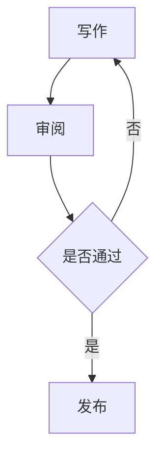

# Weavien Markdown 使用手册

> 适用：Weavien Preview 3（Writing First 系列）。本手册依据该版 Markdown 解析器、渲染器与帮助菜单源码编写。不同导出格式可能与编辑预览有所差异。
>
> **原则：Markdown 源文本是唯一可信的文档内容。** 所见格式、预览和导出均从源文本生成。遇到显示或编辑问题，优先检查原始 Markdown。

## 目录

1. [快速入门](#一快速入门)
2. [标题与正文](#二标题与正文)
3. [强调与行内格式](#三强调与行内格式)
4. [列表与任务清单](#四列表与任务清单)
5. [引用与提示块](#五引用与提示块)
6. [链接、图片与脚注](#六链接图片与脚注)
7. [表格](#七表格)
8. [代码块](#八代码块)
9. [数学公式](#九数学公式)
10. [Mermaid 图表](#十mermaid-图表)
11. [思维导图 mindmap](#十一思维导图-mindmap)
12. [公文与普通文档](#十二公文与普通文档)
13. [本地文件和工作空间](#十三本地文件和工作空间)
14. [AI 写作与 Markdown](#十四ai-写作与-markdown)
15. [故障排查和兼容性](#十五故障排查和兼容性)
16. [综合练习](#十六综合练习)

---

## 一、快速入门

新建文档，输入：

```markdown
# 我的第一篇文档

这是一段正文。Markdown 使用纯文本保存内容。

## 今日任务

- [x] 完成草稿
- [ ] 检查正文
```

在 Weavien 编辑区查看排版。标题中的 `#`、列表标记等可能在非编辑状态以简洁样式展示；**显示隐藏不等于源文本被删除**。保存为 `.md`，可用普通文本编辑器再次打开。

**推荐习惯**：标题后、段落间、列表前后留一个空行；优先使用标准 Markdown，避免依赖特殊 HTML 排版。

## 二、标题与正文

| 写法 | 用途 |
| --- | --- |
| `# 一级标题` | 文档主标题 |
| `## 二级标题` | 章节标题 |
| `### 三级标题` | 子章节 |
| `#### 四级标题` | 更细的层级 |
| `##### 五级标题` | 细分层级 |
| `###### 六级标题` | 最细层级 |

```markdown
# 年度工作总结

## 一、总体情况

第一自然段。Markdown 源文档中的段落以空行分隔。

第二自然段。

### （一）主要工作

工作内容。
```

也可使用下划线标题：

```markdown
一级标题
========

二级标题
--------
```

分隔线单独一行：

```markdown
---
```

注意：连续书写普通文本行时，换行的显示方式可能受 Markdown 段落规则影响。希望明确分段时，请加空行。

## 三、强调与行内格式

```markdown
**粗体**
*斜体*
~~删除线~~
`行内代码`

同时包含 **重点** 和 *说明*。
```

请尽量不要在强调标记内外夹杂无意义空格。若只是要显示星号、井号等字符，可在适当位置用反斜杠转义，例如 `\*不是斜体\*`。

## 四、列表与任务清单

无序列表：

```markdown
- 第一项
- 第二项
  - 第二项的子项
- 第三项
```

有序列表：

```markdown
1. 调研
2. 起草
3. 审核
```

任务清单：

```markdown
- [x] 已完成
- [ ] 待完成
- [ ] 待确认
```

Weavien 提供任务复选框的呈现与交互。列表层级建议使用一致的缩进，复杂多层嵌套要在编辑区核对。

**公文提醒**：`（一）`、`1.`、`（1）` 等公文序号不完全等于 Markdown 自动列表。需要精确保留公文序号时，建议直接把序号作为正文文本输入，不依赖自动编号。

## 五、引用与提示块

普通引用：

```markdown
> 这是一段引用。
> 引用内容可延续多行。
```

源码中也包含提示块（callout）解析与呈现。建议先采用普通引用完成通用写作；提示块的具体标记形式及跨格式导出表现，使用前应在当前安装版本里实际预览。**不要把所有 Obsidian 提示块类型都视为已验证兼容。**

## 六、链接、图片与脚注

链接与图片：

```markdown
[项目网站](https://example.com)


```

建议本地图片使用相对路径，并保持资源与文档的目录关系。Weavien 有图片资源插件，但图片能否显示还取决于图片是否存在、访问权限与路径解析；导出到其他格式也应复核。

脚注：

```markdown
这是需要补充来源的表述[^source1]。

[^source1]: 来源说明或参考资料。
```

还支持链接定义形式（由源码解析器处理）：

```markdown
[Weavien 介绍][intro]

[intro]: https://example.com "示例标题"
```

## 七、表格

使用管道符 `|` 和分隔行：

```markdown
| 项目 | 负责人 | 状态 |
| :--- | :---: | ---: |
| 方案起草 | 张某 | 完成 |
| 资料核对 | 李某 | 进行中 |
```

分隔线 `:---`、`:---:`、`---:` 分别表示左对齐、居中、右对齐的常见 Markdown 表格写法。Weavien 有独立表格解析与渲染；表格编辑建议先从简单表格开始，遇到复杂编辑时直接修改表格 Markdown 源文本。

**实用限制**：在单元格中输入字面的竖线 `|` 可能导致列数变化；可尝试转义 `\|`，并在本程序中检查效果。多行合并单元格、跨行跨列等不要按通用 Markdown 功能预期。

## 八、代码块

行内代码用反引号；多行代码用三个反引号围栏，可附语言名：

````markdown
```python
def hello():
    print("你好，Weavien")
```

```json
{"name": "Weavien", "format": "markdown"}
```
````

Weavien 对围栏代码块有显示与部分语言的语法着色支持。未知语言一般可以作为普通代码文本保留，不意味着所有编程语言都有完整高亮。

## 九、数学公式

行内公式：

```markdown
面积公式：$S=\pi r^2$。
```

块级公式：

```markdown
$$
E=mc^2
$$
```

在相关版本中还可解析部分 `\( ... \)` 行内写法。数学公式只负责表达与渲染，不会自动验证计算是否正确。

## 十、Mermaid 图表

Weavien 有 Mermaid 解析与专用图表渲染。示例：

````markdown

````

建议优先使用简洁图表语法。复杂的主题、图标、插件与 Mermaid 新版本语法是否可用，取决于 Weavien 自带的 Mermaid 版本。图表的 Markdown 代码始终是源文件内容。

## 十一、思维导图 mindmap

Weavien 还有自己的 `mindmap` 围栏内容解析与展示，不应直接等同于 Mermaid 的 `mindmap` 图类型。

````markdown
```mindmap
# 写作项目
## 资料
### 调研记录
### 引用材料
## 起草
### 初稿
### 修订
## 发布
```
````

此写法使用 Markdown 标题层级表达导图节点。具体支持的层级、编辑与导出效果可在当前版本中测试。若某个导图不显示，先检查标题层级与围栏是否闭合。

## 十二、公文与普通文档

**内容与版式分开管理**：

- Markdown 负责公文正文、标题、序号与层次内容；
- 公文预览、DOCX 导出使用 Weavien 的专门功能和模板；
- 不要假设 Markdown 的 `#` 标题能自动满足公文字体、行距、版心等所有版式规则。

公文正文示例：

```markdown
# 关于进一步做好有关工作的通知

各有关单位：

为进一步明确工作要求，现就有关事项通知如下。

一、总体要求

（一）落实工作责任。

1. 加强日常管理。

二、工作要求

各有关单位要认真组织实施。
```

在正式发文前，务必检查文种、主送机关、事实依据、责任主体、日期及导出 DOCX 的实际排版。

## 十三、本地文件和工作空间

Weavien 可以直接编辑 Markdown 文档，并支持可选的 Workspace 工作空间。工作空间主要用于查看与管理文件；不要把“工作空间文件列表”和“知识检索索引”混为一谈。

采用支持递归扫描的 Preview 3 补丁后，子文件夹中的 Markdown/文本文件可以显示为相对路径；当前仍是文件列表而非完整可展开的目录树。大型工作空间的列表上限以安装版本实际行为为准。

建议按项目组织文件：

```text
我的工作空间/
├── 项目一/
│   ├── 会议记录.md
│   └── 工作方案.md
├── 项目二/
│   └── 调研笔记.md
└── 总结.md
```

## 十四、AI 写作与 Markdown

Weavien 的 AI 可针对选区、全文或指定任务生成建议。请记住：

1. **编辑范围由作者决定**，选区之外的文本是参考上下文，不是待替换对象；
2. AI 可能生成多余标题、重复段落或未经确认的措施；
3. 对公文，尤其要防止模型自行加入政策依据、责任分工、执法程序；
4. 应先预览修改，再确认是否写回 Markdown Source；
5. 扩写、润色、续写、摘要应使用各自明确的任务模板。

详细说明参见「帮助 → AI 提示词与写作工作流」。

## 十五、故障排查和兼容性

| 现象 | 先检查什么 |
| --- | --- |
| 标题没有变大 | `#` 后是否有空格；是否处于代码块中 |
| 表格没有显示 | 是否有表头、分隔行；竖线数量是否一致 |
| 公式未渲染 | `$` 或 `$$` 是否配对；TeX 内容是否有效 |
| Mermaid 空白 | 是否使用 `mermaid` 围栏；代码本身是否合法 |
| 图片缺失 | 文件路径、资源是否存在、网络与权限 |
| 列表编号异常 | Markdown 列表与公文编号是否混用 |
| AI 输出整个原文 | 是否选错任务范围；是否将全文作为参考资料 |
| Word/PDF 与编辑区不同 | 分别检查对应的导出格式与模板设置 |

**兼容性说明**：本手册只将源码中已有解析、渲染或帮助示例的内容列为明确支持对象。HTML 嵌入、复杂表格合并、第三方扩展容器、全套 GitHub/Obsidian 扩展等，未作为已验证功能承诺。不同版本的插件启用情况也可能影响呈现。

## 十六、综合练习

把下面内容复制到新的 `.md` 文档，并检查各部分是否正常渲染：

````markdown
# 项目周报

## 一、工作进展

- [x] 完成需求整理
- [ ] 完成初稿

| 工作项 | 状态 |
| --- | --- |
| 需求分析 | 完成 |
| 文档编写 | 进行中 |

> 注意：提交前需要人工复核关键事实。

本周的完成比例示意：$p=\frac{a}{b}\times100\%$。


参考链接：[Markdown 示例](https://example.com)。
````

---

**手册维护建议**：新增 Markdown 特性时，先在解析器、编辑区和导出链路中验证，再更新本手册。不要把“其他编辑器支持”直接写成“Weavien 已支持”。
